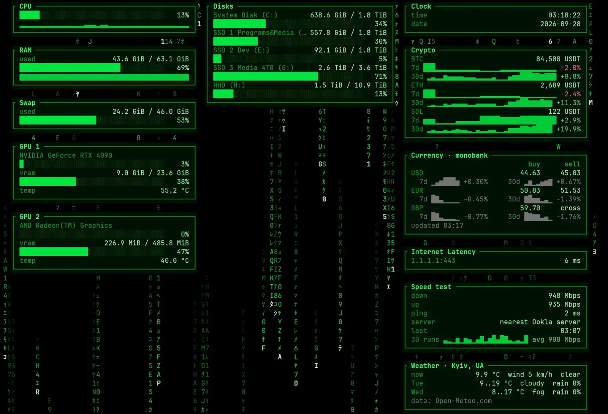

A Linux build (`telemetrix-v0.2.0-linux-x86_64.tar.gz`) is on the [release page](https://github.com/OliverD25/telemetrix/releases/tag/v0.2.0).

## What Telemetrix is

### A dashboard in your terminal

Telemetrix shows your computer's state in a terminal window: CPU, RAM, swap, disks, the CPU temperature (where the system reports it) and a Network card for mapped drives. Two themes were there from the start: **minimalist**, which is static, and **matrix**, which is digital rain. The `t` box picks a theme with a live preview.

### Settings you can edit

Settings live in a commented `telemetrix.toml`. A wrong value never stops the program, and changes in the file apply within 2 seconds. The `s` box changes and saves settings from inside the dashboard.

### Plugins in Lua

Plugins are sandboxed Lua 5.4 files. Five come by default: weather, crypto, internet latency, clock and uptime.

### Commands for scripts and agents

`snapshot [--json]`, `config init|path|check|show|reference`, `plugin check|list` and `themes` give scripts and agents the same data in text form.

### Small on memory

Telemetrix has memory budgets and shows a memory number in the status bar. `selftest --memory` checks it. It also runs on Linux, and exits cleanly on SIGTERM, SIGHUP and SIGINT.

## New in 0.2.0

### Currency and internet speed test plugins

The currency plugin shows Monobank, PrivatBank and the official NBU rate, with 7-day and 30-day graphs. The internet speed test uses the nearest Ookla server, with Cloudflare as backup. The key `g` runs it now.

### GPU card for NVIDIA

The new GPU card shows the name, load, video memory, temperature and power of an NVIDIA GPU. It is off by default (`gpu.enabled`), because it adds about 24 MB of memory. `snapshot --json` lists the GPUs in `system.gpus`.

### Three new themes

`tokyo-night`, `crt-amber` (with scanlines) and `cyberpunk`. All three are static, so they use almost no CPU.

### Screensaver command

`telemetrix screensaver install [--idle-minutes N]` registers a small watcher as a logon task. It opens the dashboard full screen after N minutes without input and closes on any key. `uninstall` and `status` go with it, and `--dry-run` shows what would change. On Linux it prints the swayidle or xautolock line instead.

### A stronger plugin engine

Plugins can now draw trend graphs in their rows, use row styles (`dim`, `header`, `good`, `bad`), keep a small stored file, define a run-now key, and have a time limit per call. They can show progress with `emit()`, add settings that the `s` box shows (with text input), and use `telemetrix.units`.

### Built-in plugins

The default plugins are built into the program and installed next to the settings file on the first start. `telemetrix plugin install` restores or updates them.

### Memory soak test

`selftest --memory --soak <minutes>` checks that memory does not grow over a long run.

## Changed and removed

- Crypto prices come from Binance instead of CoinGecko, with 7- and 30-day graphs.
- The weather card takes a city name typed in the `s` box and shows today, tomorrow and the day after. Temperatures follow `units.temperature`.
- The default total memory budget is 14 MB (was 13 MB). The core budget stays 10 MB.
- On Windows the program uses the segment heap, so private memory stays flat over hours.
- The crypto plugin stops asking Binance after an HTTP 429 answer until the next interval. After an HTTP 418 (the address is banned) it waits as long as Binance's `Retry-After` says, or else 10 minutes, doubled for every 418 in a row up to 24 hours, and shows `paused by Binance until HH:MM`.
- `telemetrix.http_get` also returns the response headers.
