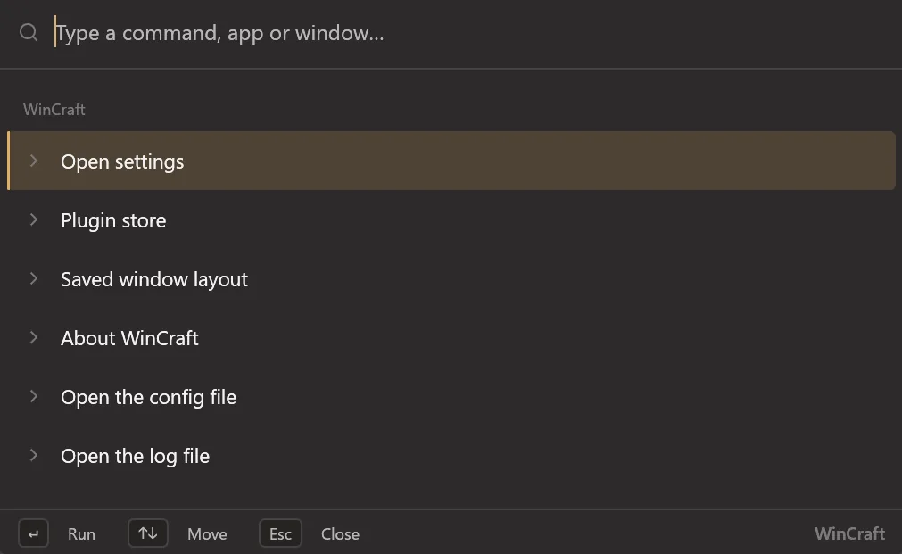
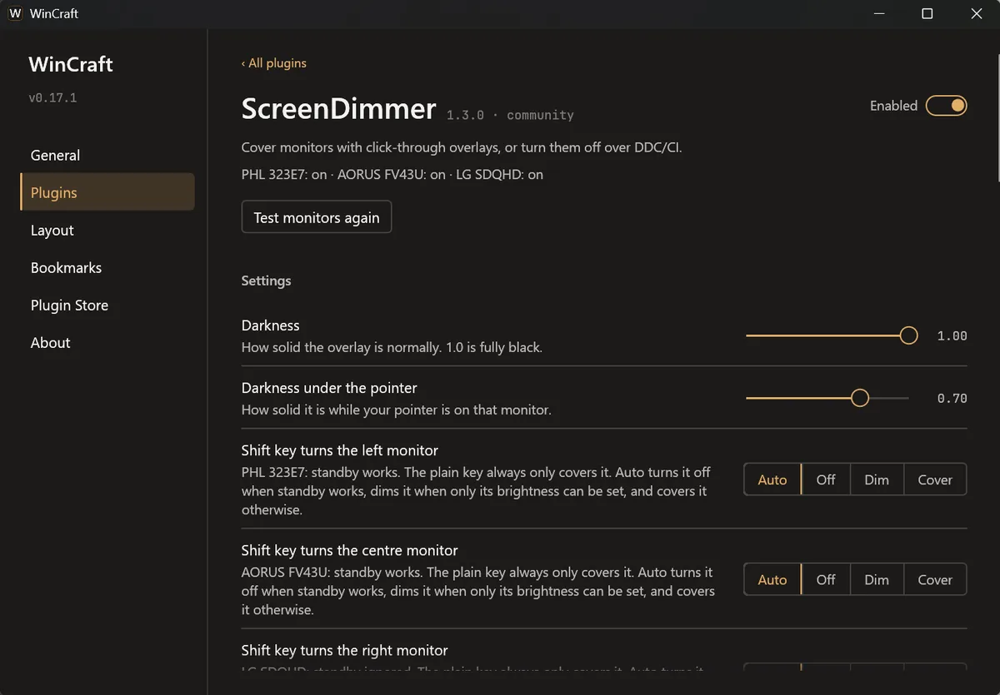
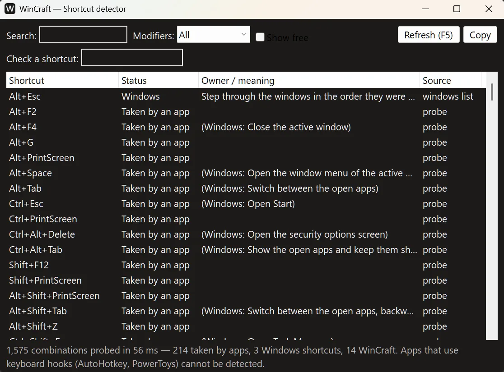
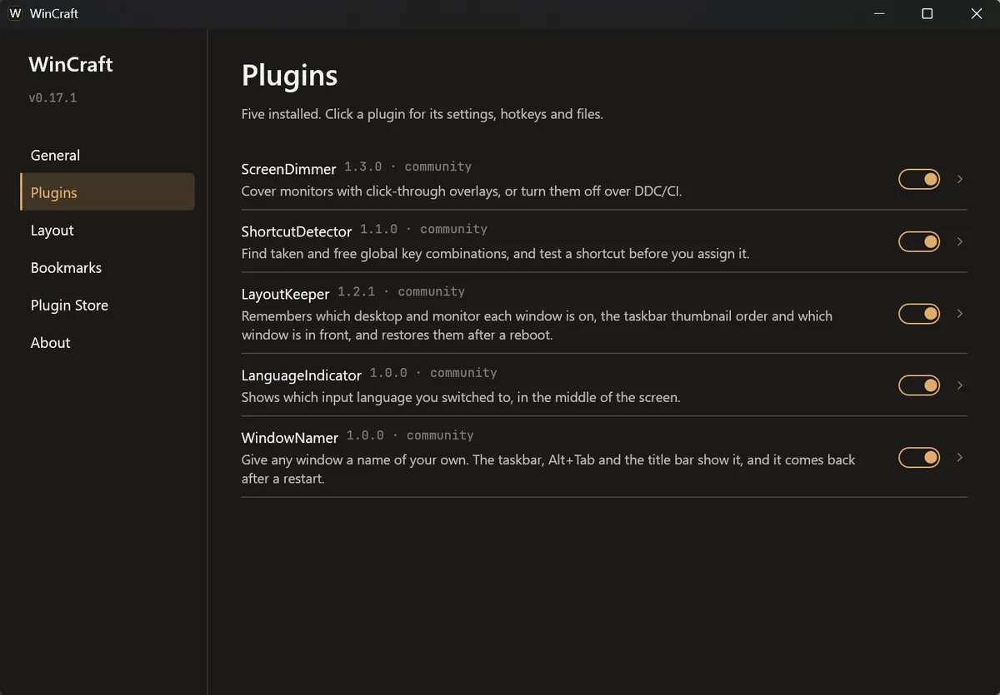

## What WinCraft is

### A tray program in the style of PowerToys

WinCraft is a small, modular utility for Windows 11. One program owns the tray icon, the start-with-Windows entry, the global hotkeys, a command palette and a settings window. Each feature is a plugin, so you can switch any of them off.

### One file

WinCraft is a single `wincraft.exe`. There is no installer and nothing to unpack. It keeps its settings in `%LOCALAPPDATA%\WinCraft`, in one file for the program and one for each plugin, so a broken edit costs one plugin and not your whole setup.

## The command palette

### One search box

`Win+Alt+P` opens a search box on the monitor your pointer is on. Type a few letters and press Enter. Without a prefix, it searches WinCraft's own commands, your apps, the windows open on any virtual desktop, your bookmarks and your files at once, and lists the best match first.

### Apps from three places

Apps come from the shortcuts in your Start menu, from the Start menu's app list (where Store apps such as Windows Terminal are), and from the programs Windows lists as installed that have no shortcut. A program found in more than one place is listed once.

### Prefixes for one kind of search

A symbol typed first sends the search to one source. `<` lists open windows, the ones Alt+Tab shows. `/` browses drives and folders, one at a time. `.` searches files and folders on every disk through Everything. `'` lists your bookmarks. `=` is a calculator. `>` runs a terminal command. `?` searches the web.

### Files through Everything

WinCraft does not index your disks. If [Everything](https://www.voidtools.com) is running, the palette asks it, and answers come in a few milliseconds. The search runs on its own thread, so a slow Everything never freezes the palette.

### Bookmarks

A bookmark is a short phrase for a folder, a file or a web address. Press Ctrl+B on a folder or file row, type the phrase, and press Enter. After that, typing the phrase puts the bookmark at the top of the list. The Bookmarks page in settings lists them with Open, Edit and Delete.

### Terminal commands

After `>`, Enter runs the command with no window and streams its output into the palette. The shell is yours to choose in settings: WSL bash, PowerShell 7, Windows PowerShell, Command Prompt or a command line of your own. A command that can delete data or stop the PC, such as `rm -rf` or `shutdown`, needs a second Enter within five seconds.

### Results you pick often move up

Each time you run an app, a command, a window, a folder or a file, it gains a point that halves every 14 days. The points reorder results that match about equally well. A clearly better match stays ahead. You can switch this off, or clear the history, in Settings, General.

### A calculator

`=` evaluates sums with `+ - * / ^ %` and brackets. After a number, `%` is a percentage (`200 * 15%` is 30). Between two numbers it is the remainder.

## The plugins

### ScreenDimmer

ScreenDimmer covers a monitor with a black overlay that you can click straight through, which turns partly see-through under your pointer. It can also turn a monitor off over DDC/CI, like its power button, without Windows moving your windows. A monitor that ignores standby is dimmed to brightness 0, and one without DDC/CI is only covered. The pointer cannot go onto a monitor that is off, and quitting WinCraft brings every monitor back. Win+Alt+F1, F2 and F3 cover the left, centre and right monitor, and adding Shift turns it off.

### ShortcutDetector

ShortcutDetector shows which global key combinations are already taken on this PC, and tells you about any combination you press before you assign it. Win+Alt+Q opens it. It cannot see programs that read keys through a keyboard hook, such as AutoHotkey scripts, and its window says so.

### LayoutKeeper

LayoutKeeper remembers which virtual desktop and which monitor each window is on, the order of the thumbnails in its taskbar group and which window is in front. After a reboot it puts them all back, while a small panel asks you to wait. It works for any app, and the Never touch setting leaves chosen apps alone. A window whose monitor is unplugged stays where it is.

### The Arrange strip

Win+Alt+A opens a strip of live pictures of an app's windows, grouped by desktop and monitor. Drag the pictures into order, to another desktop or to another monitor. Win+Alt+[ and Win+Alt+] move the front window one place left or right in its taskbar group. The Layout page in settings lists every saved window with its desktop, and shows what LayoutKeeper did recently.

### LanguageIndicator

When you switch the input language, LanguageIndicator shows a translucent panel in the middle of the screen, as macOS does. Switch from Ukrainian to English and it shows UK → EN with the language's full name under it, then fades out. It never takes the focus and lets clicks through.

### WindowNamer

WindowNamer gives any window a name of your own: three Chrome windows called Mail, Research and Bank, instead of three page titles. The taskbar thumbnail, Alt+Tab and the title bar show the name, and it stays when the app changes its title. Names come back after WinCraft or the app restarts. Win+Alt+E renames the active window.

## Settings and the plugin store

### The settings window

The settings window has General, Plugins, Layout, Bookmarks, Plugin Store and About pages. Each plugin has its own page with its options, its hotkeys, its config file and its README.

### Hotkeys

If another program already owns a combination, WinCraft keeps running, shows a tray notification, and marks that hotkey "taken by another app" on the plugin's page and on the About page. The About page lists every hotkey.

### The plugin store

The plugin store shows which plugins exist, which ones this copy has, and which need a newer WinCraft.

## Install and updates

### Install in one command

`wincraft.exe --install` copies the program to `%LOCALAPPDATA%\Programs\WinCraft`, adds it to the Start menu, points the start-with-Windows task at the new copy and starts it. It needs no administrator rights, it is safe to run twice, and it keeps a log of each step. `wincraft.exe --uninstall` removes the shortcut and the task, and leaves your settings.

### Start with Windows

The "Start with Windows" switch creates a logon task for your account only, with a five second delay after you sign in. WinCraft checks the task at each start and repairs it if it is missing or points at another copy.

### Updates from inside the app

WinCraft asks GitHub once a day whether a newer release exists. A newer one shows a tray notification, an "Update to …" item in the tray menu, and its release notes on the About page. Nothing changes until you click Update now.

### A checked, reversible update

Update now downloads `wincraft.exe` and its checksum file, checks the checksum, puts the new program in place and restarts WinCraft. If the new version does not run for 30 seconds without crashing, WinCraft ends it, puts the old program back and says so. "Check for updates daily" on the About page turns the daily check off.

### Look and feel

The interface uses Segoe UI from your own Windows installation, with a bundled fallback font when it is missing. It follows the Windows light or dark mode, or you can choose one in settings.
